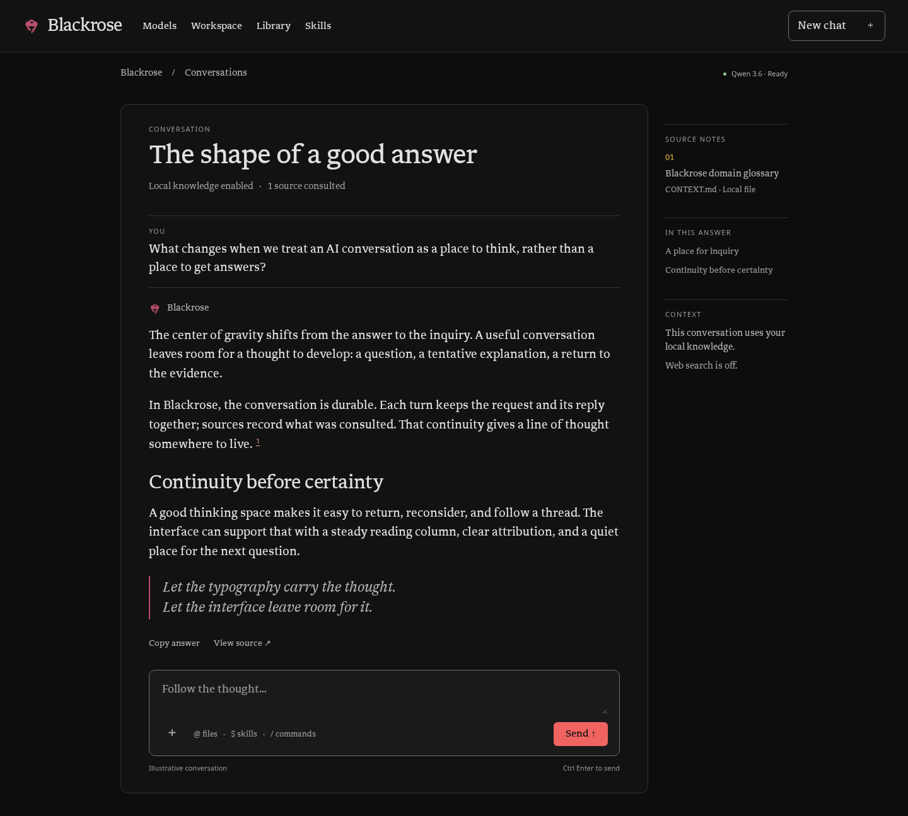

# Blackrose Bloom

A local-first desktop assistant for reading, research and writing. Blackrose
Bloom runs your own models through llama.cpp, answers from a private document
library with citations you can open, and works in your folders only with your
permission.



<sub>Reading Room design preview.</sub>

## Features

- **Local models first.** Chat with models served by llama.cpp's `llama-server`
  in router mode. Bloom can start and stop the router for you or connect to one
  you already run. Pick a model, set it as the default, and change reasoning
  effort per model. An optional cloud provider is also supported.
- **Your own library.** A built-in knowledge index (hybrid full-text and vector
  search, fully local) holds the documents you import. Answers cite the passages
  they used, and every citation opens the exact saved text.
- **Careful web research.** Optional web search through a SearXNG instance. The
  model can't fetch pages on its own authority: anything you didn't type or
  search for asks first, private network addresses are refused, and every request
  is logged with how it was authorized.
- **Citation rigor.** An optional second pass checks an answer's claims against
  its sources, gathers more evidence when needed, and flags what's still
  unsupported.
- **Workspaces.** Point a conversation at a folder. Reference files with `@`,
  have the assistant read them, and let it draft Markdown, HTML, PDF and other
  documents. New files outside the output folder and every edit to an existing
  file wait for your review, and replaced files are backed up.
- **Skills.** Install `SKILL.md` instruction packages after reviewing their full
  text, and invoke them with `$`. Five starter skills ship with the app, for
  thinking through decisions, learning, research, writing and creative work.
  Optional skill scripts run in a sandbox with no network or file access.
- **Visual answers.** Mermaid diagrams render in chat. Animated explanations,
  written in Motion Canvas, play in a sandboxed frame and export to HTML.
  Interactive answers (forms, comparisons and small charts) are experimental.
- **Image generation.** Generate and edit images locally through ComfyUI, or
  through OpenRouter when you choose to.
- **Durable conversations.** Chats, attachments and generated files are kept in
  a local database. You can reopen any conversation, retry a turn, and recover
  after a crash.

## Requirements

- Linux with GTK and WebKitGTK 4.1. On Fedora, install `webkit2gtk4.1`,
  `gobject-introspection-devel` and `cairo-gobject-devel`.
- Python 3.12 or 3.13 and [uv](https://docs.astral.sh/uv/).
- llama.cpp's `llama-server`, plus a router presets file describing your models.
- Optional:
  - a SearXNG instance for web search
  - ComfyUI for local image generation
  - `libsecret` (`secret-tool`) to store cloud API keys in the desktop keyring
  - Node.js 22.19+ to build the animation, diagram and interactive-answer runtimes
    from a checkout

## Quick start

```sh
git clone https://github.com/Rowanjgc/Blackrose-Bloom.git
cd Blackrose-Bloom
uv sync --locked --python 3.13

mkdir -p ~/.config/blackrose-bloom
cp config.example.toml ~/.config/blackrose-bloom/config.toml
# Set endpoint, default_model, llama_server_path and router_preset for your setup.

uv run --locked blackrose doctor   # checks models, library and GUI without generating anything
uv run --locked blackrose          # opens with the output folder as the workspace
uv run --locked blackrose ~/notes  # opens with a folder of your choice
```

The shipped defaults (model preset, ports and paths) match the author's machine.
Review every value in `config.example.toml` before your first launch.

To set up a document library, initialize it and download its embedding model
once. After that, retrieval works offline:

```sh
uv run --locked bloom-knowledge init
uv run --locked bloom-knowledge prefetch
```

From a checkout, build the browser runtimes once to enable animations,
interactive answers and diagrams:

```sh
for runtime in animation-runtime ui-runtime diagram-runtime; do
  npm ci --prefix "$runtime" && npm run build --prefix "$runtime"
done
```

To add Bloom to your application launcher, run
`.venv/bin/python scripts/install_desktop.py`.

## Privacy and safety

- The model can read only the workspace and folders you allow. It writes freely
  only to its own output folder, `Blackrose` inside your Downloads directory.
- Overwriting or editing an existing file always needs your approval, and the
  previous version is kept as a backup.
- Web requests the model composes itself need your approval, unless they go to
  a site you've marked as trusted. Requests to private network addresses are
  refused outright.
- Tool output, web pages, skills and remembered notes are treated as untrusted
  text. None of them can grant permissions.
- API keys live in the desktop keyring, never in configuration files, chats or
  logs.
- Nothing is sent to a cloud provider unless you select one.

## Documentation

- [User guide](docs/user-guide.md): full behavior, keyboard shortcuts,
  providers, images, skills, configuration and storage
- [Workspaces](docs/workspaces.md), [citation rigor](docs/citation-rigor.md),
  [skill scripts](docs/skill-scripts.md), [diagrams](docs/diagrams.md),
  [animations](docs/animations.md)
- [Troubleshooting](docs/troubleshooting.md) and
  [backup and recovery](docs/recovery.md)
- [Architecture](docs/architecture.md) and the
  [documentation index](docs/README.md)

## Development

```sh
uv sync --locked
.venv/bin/python scripts/check_health.py         # offline checks
.venv/bin/python scripts/check_health.py --gui   # adds the GTK/WebKit checks; needs a display
```

Neither command calls a live model or sends a paid request.
[CONTRIBUTING.md](CONTRIBUTING.md) covers repository layout, dependencies and
the full verification workflow, and [CONTEXT.md](CONTEXT.md) defines the
project's terms.

## License

MIT, for both the code and the Dragon Rose artwork; see [LICENSE](LICENSE).
Third-party components and fonts are listed in
[THIRD_PARTY_NOTICES.md](THIRD_PARTY_NOTICES.md).
